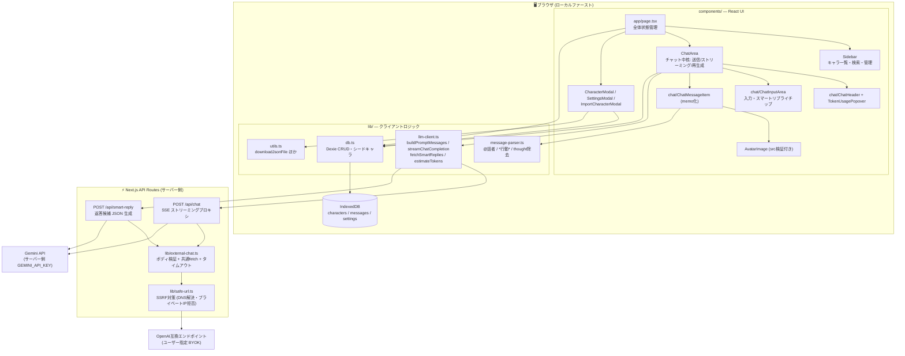
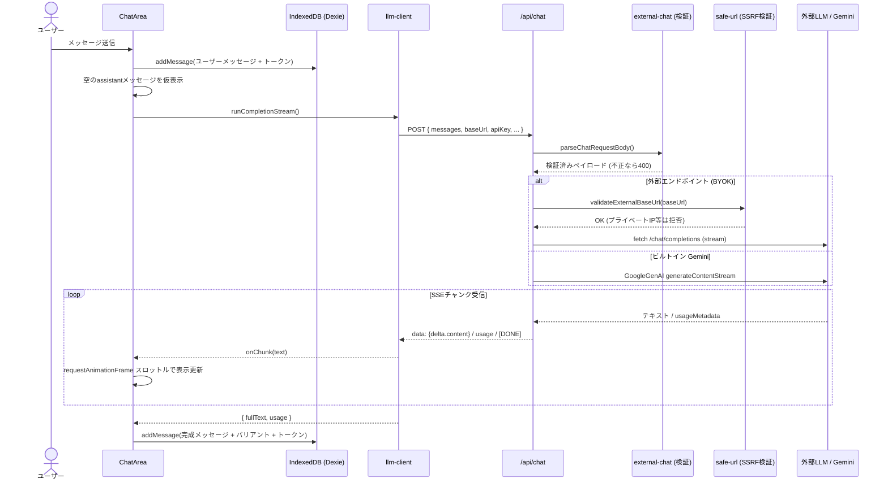
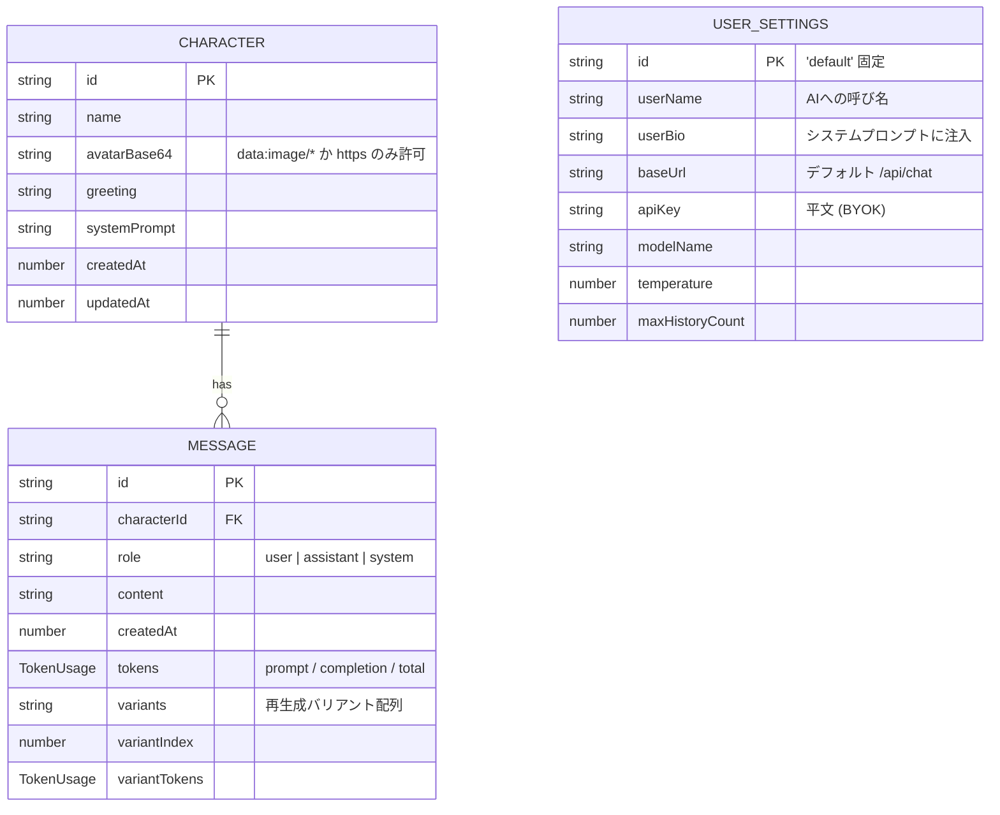

# OpenZeta アーキテクチャ

このドキュメントは OpenZeta の内部構成を Mermaid 図でまとめたものです。
（GitHub 上では自動的にレンダリングされます）

## 1. 全体アーキテクチャ

設計上のポイント:

- **ローカルファースト**: 会話・キャラ・設定はすべてブラウザ内 IndexedDB に完結し、サーバーに永続化されない
- **プロキシ方式**: クライアントは必ず `/api/chat` を経由。外部 BYOK の場合はサーバーが SSRF 検証 (`safe-url.ts`) をしてから中継し、Gemini の場合はサーバー側キーで呼び出し
- **描画パイプライン**: ストリームは requestAnimationFrame で間引き → `ChatMessageItem` (memo) が `message-parser.ts` で `@話者` / `*行動*` を解析して吹き出しと地の文を描き分け

## 2. チャット送信〜ストリーミングのシーケンス

## 3. データモデル (IndexedDB / Dexie)

セキュリティ設計の詳細は [SECURITY.md](SECURITY.md) を参照してください。
